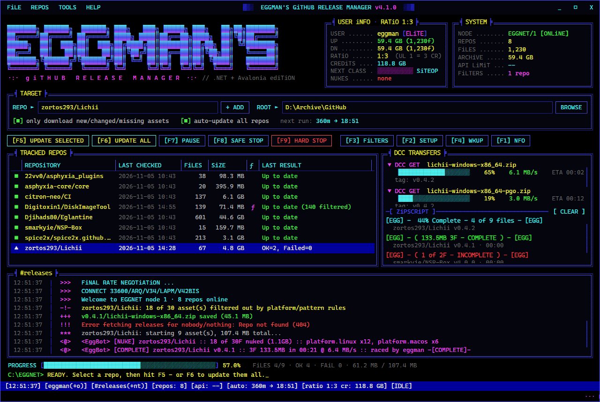
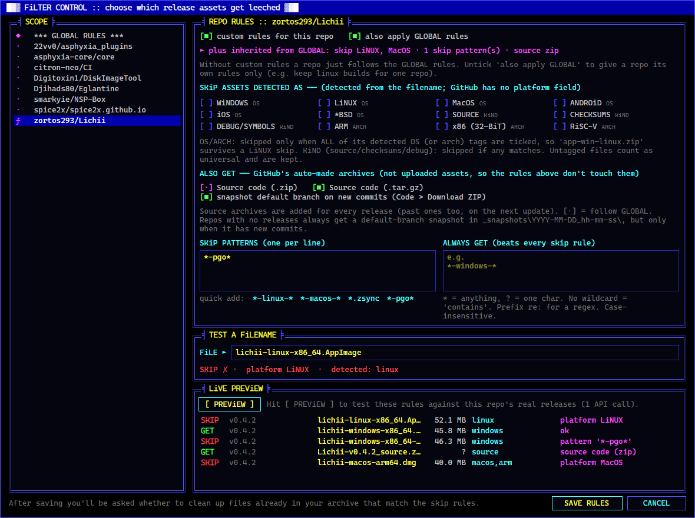

## A Note on AI-Assisted Development

This project was built with AI as a code design and development tool. That
means an AI model helped draft, structure, and troubleshoot portions of the
code — but every line went through a human (me) for review, testing, and final
approval. The AI proposes; I dispose. Nothing here shipped without my sign-off,
and I take responsibility for what's in the repository.

This disclaimer isn't here to sell you on AI-assisted coding or argue the point.
It's here so you know exactly how this project was made. If the use of AI in the
development process is a dealbreaker for you, that's a completely valid stance —
this just isn't the project for you. No hard feelings; feel free to move along.

---

# Eggman's GitHub Release Manager

A multi-repo GitHub release downloader with metadata tracking, incremental updates, hash verification, platform filtering, auto-update scheduling, Discord notifications, and export utilities including RomVault DATs, PDF summaries and CSV/JSON metadata.

**v4** is a ground-up rewrite in **C# / .NET 10 + Avalonia**, with a BBS / warez-scene / IRC-inspired interface: ANSI-shadow logo, double-line frames, `[■]` checkboxes, a "DCC TRANSFERS" panel, an irssi-style log and status bar, CRT scanlines and a cracktro scroller. It reads the v3 (Python) config and repo database unchanged, so an upgrade picks up exactly where v3 left off.



---

## What's new in v4

- **Platform filters**: skip release assets you don't collect (Linux, macOS, Android, ARM builds, checksums, source archives…). Set them globally, per repo, or both, and preview them against a repo's real releases before saving. See [Platform Filters](#platform-filters).
- **Filter cleanup**: after you change the rules, files already in your archive that now match can be sent to the Recycle Bin or moved aside.
- **Dial-up handshake on startup**: a real 56k-era handshake recording plays while the AT commands scroll by in time with it: dial tone, DTMF dialing 1-800-EGG-MAN1 (1-800-344-6261), ringing, V.8 negotiation, the 2100 Hz answer tone, line probing, V.34 training and CONNECT. Switch it off, or play it on demand with *♪ DiAL NOW*, in SETUP.
- **1:3 ratio box**: a topsite-style USER iNFO panel. Your archive is the site: every byte you race in counts as UP and earns 3 bytes of credit, and every byte pulled from GitHub (re-downloads included) counts as DN. Your class (NEWBiE → USER → ViP → ELiTE → SiTEOP → LEGEND) goes up with the size of your archive, and each finished update logs its race stats.
- **Your own greetz**: edit the cracktro scroller in SETUP. Each line is one message; *RESTORE DEFAULT GREETZ* brings back the stock ones.
- **Your handle**: set your oldschool BBS handle in SETUP (up to 30 characters, WWIV's limit). It shows in USER iNFO, the status bar, the sitebot announcements and every FILE_ID.DIZ. Blank uses your Windows user name.
- **Zipscript race board**: each release being downloaded gets a pzs-ng style line under DCC TRANSFERS, like `[EGG] - 44% Complete - 4 of 9 files - [EGG]`. It turns into `[EGG] - ( 107.4MB 9F - COMPLETE ) - [EGG]` when done (or INCOMPLETE / STOPPED). Results stay on screen until you press *[ CLEAR ]*.
- **EggBot sitebot**: #releases gets IRC-style announcements: `[NEW]` for a release you didn't have, `[COMPLETE]` with size, time and speed, and `[NUKE]` for assets your filters skipped, grouped by reason (`platform.linux x12`).
- **Nukes**: filtered assets are counted as nukes and shown in USER iNFO.
- **FILE_ID.DIZ**: every release folder gets a 45-column ASCII FILE_ID.DIZ next to `release_notes.txt`. Neither file counts as an orphan or an asset. You can switch it off in SETUP.
- **site wkup**: *F4* (or TOOLS → Top Uploaders) shows WKUP, MONTHUP and ALLUP boards, ranking your repos by what you archived this week, this month and in total.
- **Site rules**: *F1* shows the site rules first, typed out like a 2400 baud login (space skips). *I AGREE* takes you on to the NFO.
- **Sound fx**: a ZMODEM-style triple beep when downloads finish, and the NO CARRIER hang-up when you quit. You can switch them off in SETUP.
- **31337 5P34K**: a toggle in SETUP that runs every bit of on-screen text through an elite translator. Text you type is left alone.
- **Source code archives**: optionally grab GitHub's "Source code" zip and/or tar.gz for every release, saved as `<repo>-<tag>_source.zip` / `.tar.gz`. See [Source code archives and branch snapshots](#source-code-archives-and-branch-snapshots).
- **Branch snapshots**: repos with no releases get a datestamped *Code → Download ZIP* snapshot of their default branch whenever it gets new commits. Other repos can opt in.
- **New look**: four colour schemes (ANSi Classic, Amber Terminal, Green Phosphor, ACiD Trip) with a live preview, a configurable font, and CRT and scroller effects you can switch off.
- **Single portable exe**: no Python, pip or batch files. Config and DB still live next to the exe.
- **Keyboard driven**: F5 update selected · F6 update all · F7 pause · F8 safe stop · F9 hard stop · F3 filters · F2 setup · F1 nfo
- **Live transfer view**: per-file progress, speed and ETA for every download thread, plus an overall byte-based progress bar
- **API rate-limit meter** in the SYSTEM box and status bar, with clear rate-limit, 404 and bad-token messages
- **Safer storage**: the repo DB is written atomically (temp file + replace), and an unreadable DB is kept as `*.corrupt_<time>` instead of being overwritten
- **Fixes over v3**:
  - `release_notes.txt` is no longer treated as an orphan or indexed as an asset
  - DAT entries are XML-escaped and CRC32 is streamed instead of loading the whole file into RAM
  - release notes are only rewritten when they change
  - files already on disk but missing from the DB are hashed into the DB
  - a run stopped with Safe Stop still records the files that finished
  - one fewer API call per repo

---

## Requirements

- Windows 10/11 x64
- [.NET 10 Desktop Runtime](https://dotnet.microsoft.com/download/dotnet/10.0) (or the SDK)

Recommended font: **Cascadia Mono** (ships with Windows 11). For the full DOS look, install *Px437 IBM VGA 8x16* from the [Ultimate Oldschool PC Font Pack](https://int10h.org/oldschool-pc-fonts/) and put it first in **SETUP → FONT FAMiLY**.

---

## Running

Download the release zip, unpack it anywhere and run `Eggmans_GitHub_Release_Manager.exe`.

- The app is fully portable. Its config, DB and logs sit next to the exe, so you can move the folder and it picks up where it left off.
- **Upgrading from v3:** unpack into your existing folder. The v3 `*_config.json`, `*_repos.json` and `tracked_repos.txt` are read as-is. The old `.pyw` and batch files are no longer needed.

### Building from source

```
dotnet build
dotnet test --project tests/EggmansReleaseManager.Tests
.\publish.ps1            # test, publish, zip, then unpack into C:\Utilities\Eggmans_GitHub_Release_Manager
.\publish.ps1 -NoDeploy  # just produce artifacts\Eggmans_GitHub_Release_Manager_v<ver>_win-x64.zip
```

`publish.ps1` backs up the target folder's config, DB and tracked list to `_backup\<timestamp>\` before unpacking. It never overwrites them, because they aren't in the zip.

---

## Config Files

All of these are stored next to the exe and created automatically on first run.

| File | Contents |
|---|---|
| `Eggmans_GitHub_Release_Manager_config.json` | Root folder, webhook URL, API token, thread count, auto-update settings, **filters**, theme/font/effects, window size |
| `Eggmans_GitHub_Release_Manager_repos.json` | Per-repo metadata: last_checked, last_result, asset hashes, sizes, and paths (same format as v3) |
| `tracked_repos.txt` | Plain list of tracked repos, updated automatically. Repos added here by hand are merged in on startup |
| `_logs\session_YYYY-MM-DD.log` | Copy of the activity log |

> **Keep the config file out of git.** It contains your GitHub token and Discord webhook in plain text. The included `.gitignore` already excludes it.

---

## File Organization

```
<root_download_folder>\
    owner_repo\
        <tag1>\
            asset files...
            <repo>-<tag1>_source.zip      (if source archives are on)
            <repo>-<tag1>_source.tar.gz   (if source archives are on)
            release_notes.txt
            FILE_ID.DIZ
        <tag2>\
        _snapshots\
            2026-11-07_14-30-05\
                <repo>-main.zip
                snapshot_info.txt
        orphans\
    _metadata\
        json\  csv\  dat\  pdf\  logs\
```

- All metadata (JSON/CSV/DAT/PDF/TXT) is stored under `_metadata`, separate from downloaded files
- Legacy metadata found in the root folder is migrated automatically
- All timestamps use UTC in the format `YYYY-MM-DD_HH_MM_SSZ`

---

## Platform Filters

GitHub has no "platform" field on release assets, so v4 works it out from the **filename**. The name is lower-cased, `x86_64`/`amd64` become `x64`, and it is split into words:

```
lichii-linux-x86_64-pgo.AppImage  ->  lichii · linux · x64 · pgo · appimage   =>  LiNUX
lichii-macos-arm64.dmg            ->  lichii · macos · arm64 · dmg              =>  MacOS + ARM
NSP-Box-v4.0.0-Windows-x64.zip    ->  ... windows ...                           =>  WiNDOWS
DiskImageTool_1.18.0.1.zip        ->  (nothing recognised)                      =>  universal, always kept
```

| Tag | Kind | Recognised by |
|---|---|---|
| WiNDOWS | OS | win, win32/64, windows, msvc, mingw, `.exe .msi .msix .appx` |
| LiNUX | OS | linux, ubuntu, debian, fedora, musl, steamdeck, `.AppImage .deb .rpm .flatpak .snap .zsync .pkg.tar.zst` |
| MacOS | OS | mac, macos, osx, darwin, universal2, `.dmg .pkg` |
| ANDROiD | OS | android, `.apk .aab` |
| iOS | OS | ios, iphone, ipad, `.ipa` |
| *BSD | OS | freebsd, openbsd, netbsd |
| ARM / x86 (32-bit) / RiSC-V | ARCH | arm64, aarch64, armv7 · x86, i386, i686 · riscv64 |
| SOURCE / CHECKSUMS / DEBUG | KiND | src, source · SHA256SUMS, `.sha256 .sig .asc` · pdb, dsym, symbols |

**How a decision is made** (in this order):

1. **ALWAYS GET patterns**: a match is always downloaded and beats every skip rule.
2. **SKIP patterns**: a match is skipped.
3. **Tags**:
   - OS and ARCH: an asset is skipped only when *all* of its OS (or ARCH) tags are ticked, so `app-win-linux.zip` survives a LiNUX skip.
   - KiND: an asset is skipped if *any* of its KiND tags is ticked.

Patterns are case-insensitive globs (`*` = anything, `?` = one character). A pattern without a wildcard means "contains", and the prefix `re:` makes it a regular expression, e.g. `re:-pgo\.(zip|tar\.gz)$`.

**Scopes**: open **FiLTER CONTROL** (F3, or right-click a repo → *Filters For This Repo*).

- **GLOBAL rules** apply to every repo.
- A repo can have **custom rules**. By default these are added on top of the global rules. Untick *also apply GLOBAL rules* to give that repo its own rules only (e.g. you skip Linux everywhere but want it for one repo).
- **TEST A FiLENAME** shows the verdict for any name as you type.
- **LiVE PREViEW** fetches the repo's newest 100 releases (one API call) and lists every asset as GET or SKIP, with the reason.

**Cleaning up what you already have**: when you save rules, the app checks your archive for files that the rules would now skip and asks what to do:

- **RECYCLE BIN** sends them to the Windows Recycle Bin, so you can undo it.
- **MOVE TO _filtered** moves them to `owner_repo\_filtered\<tag>\`.
- **LEAVE THEM** keeps everything as it is.

Cleaned files are removed from the repo DB, and tag folders left holding only `release_notes.txt` are removed. You can run the same check any time from **TOOLS → Clean Up Filtered Files**. The `orphans` and `_filtered` folders are never scanned.

A release whose assets are all filtered out gets no folder. The Last Result column reports how many assets were filtered (e.g. `Up to date (140 filtered)`).



### Source code archives and branch snapshots

GitHub builds two extra downloads for every release, "Source code (zip)" and "Source code (tar.gz)". They aren't uploaded assets, so the platform and pattern rules don't apply to them. Instead they have their own switches under **ALSO GET** in Filter Control:

- **Source code (.zip)** / **Source code (.tar.gz)**: tick either or both, globally or per repo. In a repo's rules the boxes have a third state, `[·]`, which means "follow GLOBAL".
- Files are saved in each release folder as `<repo>-<tag>_source.zip` / `<repo>-<tag>_source.tar.gz`.
- Both are **off by default**. Switching one on fills in every past release on the next update, not just new ones.
- GitHub makes these archives on the fly, so their size isn't known until they've downloaded. Progress for them counts files instead of bytes.
- If you switch a format off again, the cleanup prompt offers to remove the archives you already have.

**Default-branch snapshots** (the same as *Code → Download ZIP*):

- Repos with **no releases at all** are snapshotted automatically. Any other repo can opt in with **snapshot default branch on new commits** in its own rules.
- A snapshot is stored in `owner_repo\_snapshots\YYYY-MM-DD_hh-mm-ss\` (local time) as `<repo>-<branch>.zip`, alongside a `snapshot_info.txt` that records the branch and the exact commit.
- A new snapshot is only taken when the default branch has a **new commit**, so auto-update doesn't pile up identical copies. Old snapshots are kept.
- Checking for new commits uses 2 API calls per repo.

---

## Dashboard Usage

1. **Add a repo**: type `owner/repo` or paste any GitHub URL (it converts automatically), then **+ ADD**.
2. **Set a root folder**: type it, use **BROWSE**, or drop a folder onto the box. Everything downloads to `root/owner_repo/tag/asset.ext`.
3. **Update one repo**: select it and press **F5**, or right-click → *Update This Repo*.
4. **Update all repos**: press **F6**. Repos are processed oldest-checked first.

| Action on the repo list | Result |
|---|---|
| Click | Selects the repo (fills the REPO box) |
| Drag a column edge | Resizes that column (widths are remembered); a horizontal scrollbar appears when they don't fit |
| Click a column header | Sorts by that column |
| Double-click | Opens the repo folder in Explorer |
| Right-click | Update · Open on GitHub · Open Folder · Filters · Hash Rescan · DAT · PDF · Orphans · Scan Local · Remove |

| Glyph / colour | Meaning |
|---|---|
| `■` green | Up to date |
| `▲` yellow | Assets downloaded (changes found) |
| `×` red | One or more failed downloads, or an API error |
| `·` grey | Not yet checked |
| `ƒ` | Repo has its own filter rules |

---

## Controls

| Key / Button | Action |
|---|---|
| **F5** UPDATE SELECTED | Fetch and download assets for the repo in the REPO box |
| **F6** UPDATE ALL | Batch update all tracked repos |
| **F7** PAUSE / RESUME | Suspend and resume active downloads |
| **F8** SAFE STOP | Finish current downloads, skip the rest (finished files are still recorded) |
| **F9** HARD STOP | Abort immediately; partial files are kept and resumed next time |
| **F3** FiLTERS | Filter control |
| **F2** SETUP | Threads, auto-update, token, webhook, colour scheme, font, effects |
| **F1** NFO | About |

---

## Export & Maintenance Tools

- **Generate DAT**: RomVault-compatible XML `.dat`. Game name = release tag; nested files keep their relative path. CRC32 and SHA-1 are included per file, and CRCs are cached in the DB after the first run.
- **Generate PDF Summary**: a per-repo listing of tag / file / size / SHA-1. Built in, so nothing extra to install.
- **Export DB**: saves the repos JSON database to a location of your choice.
- **Cleanup Orphans**: moves files not listed in the metadata to `owner_repo/orphans/`. You see a preview and confirm first, and `release_notes.txt` is ignored.
- **Force Hash Rescan**: recomputes SHA-1 for every known asset, in the background.
- **Scan Local Files**: indexes existing files using top-level subfolders as tags, and recreates missing JSON/CSV metadata.

---

## GitHub API Token

| Access | Rate Limit |
|---|---|
| Anonymous | 60 requests/hour |
| Authenticated (token) | 5,000 requests/hour |

To create a token, go to [github.com/settings/tokens/new](https://github.com/settings/tokens/new) and choose a **Personal access token (classic)**. No scopes are needed for public repos. Paste it into **SETUP → GiTHUB TOKEN**.

The SYSTEM box shows your remaining API calls after every request.

---

## Discord Notifications & Auto-Update

- **Discord**: put a webhook URL in SETUP. After each repo update it posts `repo: update finished — OK=xx, failed=yy`.
- **Auto-update**: tick *auto-update all repos* and set the interval in SETUP (minimum 5 minutes). The next run time shows in the TARGET panel and the status bar. Auto runs log their results instead of popping up a dialog.

---

## Project Layout

```
src/EggmansReleaseManager/      the app (Avalonia, MVVM via CommunityToolkit.Mvvm)
  Services/                     GitHub API, downloader, filters, DAT/PDF/CSV export, maintenance
  ViewModels/  Views/  Themes/  UI/
tests/EggmansReleaseManager.Tests/   xUnit tests (filters on real asset names, v3 file compatibility, DAT/PDF, planning)
legacy/python/                  the v3 Python/Tkinter version, kept for reference
publish.ps1                     test → publish → zip → deploy
```

---

## Licensing

Original source code, scripts, tooling, and hand-authored documentation and metadata in this repository are licensed under the **MIT License**.

Archived game data, binaries, firmware, media assets, and other third-party materials are **not** covered by the MIT License and remain the property of their respective copyright holders.

See the `LICENSE` and `NOTICE` files for full details and scope clarification.

---

## Credits

Created for the preservation community by Eggman, with Claude's help turning ideas into code.

If you improve it, feel free to share your changes back with the community.
